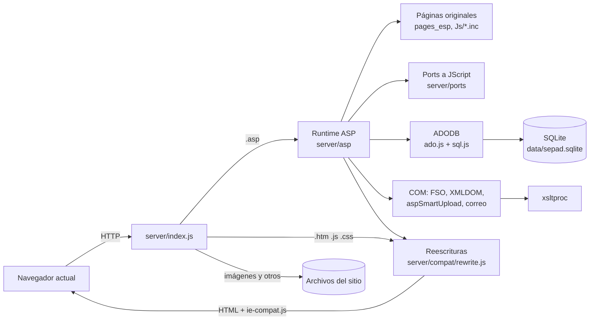

# Arquitectura

## Principio

La interfaz original es el producto. En lugar de reescribir unas 270 páginas, el proyecto reproduce el entorno donde corrían (IIS, ASP, ADO, COM e Internet Explorer 5) y las ejecuta casi sin cambios. Todo lo nuevo vive en `server/`; las páginas originales solo se modificaron para corregir errores que también las rompían en IIS.

## Componentes

| Pieza | Archivo | Papel |
| --- | --- | --- |
| Servidor HTTP | `server/index.js` | Enruta `.asp` al runtime, sirve archivos estáticos, bloquea rutas sensibles y restaura los datos de demostración |
| Compilador | `server/asp/compiler.js` | Convierte cada `.asp` (con sus `#include`) en un script de Node, con caché |
| Reescritura JScript | `server/asp/jsrewrite.js` | Adapta la sintaxis de JScript que JavaScript no acepta |
| Objetos de ASP | `server/asp/runtime.js` | `Request`, `Response`, `Server`, `Session`, `Application`, `global.asa` y la página de error |
| Proxies COM | `server/asp/com.js` | Miembros sin distinguir mayúsculas, objetos invocables, `Scripting.Dictionary`, `Enumerator` |
| ADODB | `server/asp/ado.js` | `Connection`, `Recordset`, `Command` y `Field` sobre better-sqlite3 |
| Dialecto SQL | `server/asp/sql.js` | Traduce Access/SQL Server a SQLite y define sus funciones |
| Componentes COM | `server/asp/objects.js` | `FileSystemObject`, `Microsoft.XMLDOM`, `aspSmartUpload`, correo simulado |
| Rutas | `server/asp/fsci.js` | Rutas sin distinguir mayúsculas y rutas de Windows escritas en el código |
| Compatibilidad IE | `server/compat/` | Shim de cliente y reescrituras de HTML, JS y CSS |
| Ports | `server/ports/` | Páginas VBScript reescritas en JScript |

## Recorrido de una petición

1. `server/index.js` decodifica la URL y rechaza las rutas bloqueadas. Busca el archivo sin distinguir mayúsculas; si es un `.asp` que ya no existe pero tiene un port en `server/ports/`, usa el port.
2. Para un `.asp`, lee el cuerpo completo de la petición y llama a `AspApplication.execute`.
3. El runtime busca la sesión por la cookie `ASPSESSIONID…` o crea una nueva (y ejecuta `Session_OnStart` de `global.asa`).
4. Obtiene la página compilada (de la caché, que se invalida al cambiar el archivo) y la ejecuta en un contexto `vm` nuevo con los objetos de ASP como globales. Todo es síncrono, como en ASP: cada petición termina antes de atender la siguiente.
5. `Response.Redirect` y `Response.End` cortan la ejecución. Un error no capturado se convierte en la página de error de IIS (`Microsoft JScript runtime error '800a138f'`, con archivo y línea originales).
6. La salida se codifica en ISO-8859-1. Si es HTML, se le aplican las reescrituras de compatibilidad y se inyecta `/__sepad/ie-compat.js`.

Los archivos estáticos siguen el mismo camino desde el paso 1: los `.htm`, `.js` y `.css` pasan por las reescrituras (salvo TinyMCE y el editor wysiwyg, que ya eran multinavegador), y el resto se sirve tal cual.

## Decisiones

- **Node.js y JavaScript**: el código de servidor ya era JScript, el mismo lenguaje que JavaScript, así que puede ejecutarse directamente. Solo hay que adaptar unas pocas construcciones.
- **SQLite**: es un archivo, no requiere servidor y se puede restaurar copiando un archivo. better-sqlite3 es síncrono, como ADO.
- **Contexto `vm` por petición**: las páginas usan muchas variables globales implícitas; un contexto nuevo evita que se filtren entre peticiones.
- **Latin-1 de punta a punta**: los archivos, los formularios y la salida usan ISO-8859-1, igual que en 1998, para que los acentos se vean bien sin tocar los archivos.
- **Ports en lugar de un intérprete de VBScript**: solo 4 páginas estaban en VBScript, y escribir un intérprete completo no compensaba.
